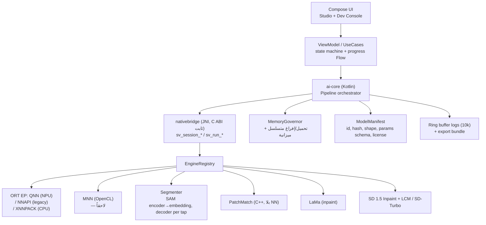

# مجلس الوكلاء — مراجعة تصميم ShadowVision2

> **الغرض:** مراجعة نقدية للتصميم المقترح (تطبيق أندرويد للتقسيم + الاستكمال الداخلي، يعمل محلياً بالكامل) من زوايا هندسية متعددة، وتقديم قرارات تقنية قابلة للتنفيذ.
> **الحالة:** مراجعة تصميم (Design Review) — لا كود بعد.
> **تاريخ المراجعة:** 2026-11-09

---

## 0. كيف قُرئت الفكرة

الفكرة كما فُهمت:

1. تطبيق أندرويد يعمل بلا أي خادم خارجي، والاستدلال العصبي كله على الجهاز.
2. طبقة C++ أصلية (ONNX Runtime Mobile أو NCNN) مفصولة تماماً عن الواجهة.
3. خط أنابيب من مرحلتين: **تقسيم** (MobileSAM / U-Net) ثم **استكمال** (SD 1.5 Inpainting مكمَّم INT4/INT8، أو SD-Turbo / LCM).
4. واجهتان: **استوديو المستخدم** (فرشاة + ماسك + تكبير + تنفيذ) و**لوحة تحكم المحرك** (إدارة النماذج، اختيار المسرّع CPU/GPU/NPU، CFG/Steps/Seed، سجلات حيّة للموارد).

هذا ملخص أمين. النقاش التالي يفترض أن الهدف النهائي **إزالة/تعديل عناصر في صورة**، لا توليد صور من الصفر.

---

## 1. تشكيلة المجلس

| الوكيل | الاختصاص | العدسة التي يرى بها القرار |
|---|---|---|
| **A1 — معمارية الأنظمة** | طبقات، عقود، حدود الوحدات | قابلية الاستبدال والصيانة |
| **A2 — مهندس أداء C++/NDK** | JNI، ذاكرة، خيوط، أرضية الأداء | زمن الاستجابة والذاكرة |
| **A3 — باحث تعلّم آلي** | اختيار النماذج، التكميم، الجودة | جودة الناتج مقابل التكلفة |
| **A4 — مهندس منصة أندرويد** | NPU/GPU delegates، خدمات، نشر | الواقع على الأجهزة |
| **A5 — منتج وتجربة استخدام** | تدفّق العمل، التوقّعات، الإحباط | هل يشعر المستخدم أنه سريع؟ |
| **A6 — مراجعة قانونية وتراخيص** | رخص النماذج، سياسات Play | قابلية الشحن تجارياً |
| **A7 — ضمان الجودة والموثوقية** | اختبارات، OOM، حرارة، انهيارات | هل يعمل على 200 جهاز؟ |
| **A8 — محامي الشيطان (Red Team)** | مهاجمة الفكرة نفسها | هل نبني هذا أصلاً؟ |

---

## 2. الحكم السريع (Verdict)

**التصميم صحيح في هيكله، وخاطئ في نقطتين قاتلتين.**

✅ **ما يصح:**
- الفصل الصارم بين الواجهة والاستدلال عبر طبقة أصلية — قرار سليم ومبكر.
- خط الأنابيب على مرحلتين — صحيح مفاهيمياً.
- واجهة تحكم للمحرك — قيمة تشخيصية عالية.
- التشغيل المحلي الكامل — ميزة تنافسية حقيقية (خصوصية مطلقة، بلا تكلفة استدلال، بلا حدود استعمال).

❌ **النقطة القاتلة الأولى — «SD 1.5 Inpainting مكمَّم INT4/INT8 كملف ONNX واحد يعمل على كل الأجهزة» لا وجود له عملياً.**
- على المعالج (CPU): UNet بـ 860M معامل عند 512×512 × 20 خطوة = **دقائق** على هاتف. قياسات موثّقة على Galaxy S25 Ultra (SD 8 Elite) لعملية SD 1.5 كاملةً على CPU: **5 دقائق و37 ثانية**؛ وعلى جهاز أقدم: **14 دقيقة**.
- على NPU: لا يعمل عبر NNAPI (أُهمِل في Android 15)، بل عبر **QNN**، و QNN HTP **لا يقبل إلا نماذج مكمَّمة بأشكال ثابتة (static shapes)**، ويحتاج **context binary مُصرَّفاً لكل شريحة على حدة** (HTP v69/v73/v75/v79/v81). أي أن «ملف ONNX واحد للجميع» لا يعطي تسريعاً على الـNPU إطلاقاً.
- النتيجة: الوعد التسويقي «توليد على الجهاز» يتحقق على **الرايات فقط**، وينهار على الأجهزة المتوسطة.

❌ **النقطة القاتلة الثانية — افتراض أن مهمة المستخدم كلها تحتاج انتشاراً (diffusion).**
- 80–90% من حالات الاستخدام هي **«أزل هذا الشيء»**، وهي مهمة **إزالة** لا **توليد**. نموذج LaMa (174MB، ~46M معامل) يحلّها في **49–75 مللي ثانية** على NPU، وعلى CPU في نطاق ثوانٍ قليلة، بناتج حتمي (deterministic) وبلا برومبت ولا CFG ولا Seed.
- بناء المنتج حول diffusion أولاً = تكلفة 20–100 ضعف لأجل 10–20% من الحالات.

**توصية المجلس (إجماع):** أعد ترتيب الهرم. اجعل **LaMa هو المسار الافتراضي**، و**LCM/SD-Turbo هو المسار الإبداعي الاختياري** (وضع «تخيّل بدلاً من هذا»)، وحوّل النقاش كله من «كيف نشغّل SD على الهاتف» إلى «كيف نختار أرخص أداة تحقق النتيجة».

---

## 3. الخلافات الخمسة الكبرى وأصوات المجلس

### 3.1 محرك الاستدلال: ONNX Runtime أم NCNN؟

| الوكيل | الموقف |
|---|---|
| A2 | ORT أنضج في التكميم والتوافق مع نماذج PyTorch. NCNN لا يملك مسار NPU إطلاقاً، وفرع SD/Vulkan فيه متوقف عملياً منذ 2023. |
| A4 | ORT يملك حزمة `onnxruntime-android-qnn` جاهزة على Maven — هذا وحده يوفّر أسابيع عمل. |
| A1 | المشكلة ليست الاختيار بل **الاقتران**: يجب ألا يعرف كود المنتج أي محرك. |
| A8 | كلاهما سيتغير. استثمر في **طبقة تجريد**، لا في محرك. |

**القرار:** `ONNX Runtime (onnxruntime-android + onnxruntime-android-qnn)` كمحرك أساسي، خلف واجهة `IEngine` مجرّدة. **NCNN يُستبعد** من نطاق المنصة. يُترك المنفذ الثاني لـ **MNN** (رخصة Apache-2.0، ويعمل على OpenCL لأي GPU) كخطة بديلة للأجهزة غير السنابدراغون — لا يُبنى الآن، بل يُحترم في التصميم.

> ⚠️ تنبيه عملي: لا تستخدم حزمة `onnxruntime-mobile` (آخر إصدار 2024، مهملة). استخدم `onnxruntime-android` أو `onnxruntime-android-qnn`.

**الأصوات:** 7 مع، 1 ممتنع (A8 يطالب بإثبات أولاً).

---

### 3.2 التقسيم: MobileSAM أم EdgeSAM؟

| النموذج | السرعة | الترخيص | الحكم |
|---|---|---|---|
| MobileSAM | ~4.9 FPS على iPhone 14 | **Apache-2.0** | ✅ آمن تجارياً |
| EdgeSAM | أسرع ~14× على الأجهزة | **NTU S-Lab 1.0 — غير تجاري** | ❌ لا يُشحن في نسخة تجارية |
| U-Net مخصص | سريع جداً | حسب بياناتك | ⚠️ يحتاج تدريباً وبيانات موسومة |

**القرار:** MobileSAM (Apache-2.0) كافتراضي. EdgeSAM لا يدخل حزمة Play؛ يمكن دعمه كـ«حزمة نموذج اختيارية يثبّتها المستخدم بنفسه» إن أردت، مع توضيح الترخيص في اللوحة — لكن لا تبنِ عليه تجربة المستخدم الأساسية.

**البصيرة الأهم (A2 + A3):** لا تُشغّل الـEncoder عند كل لمسة. قسّم النموذج إلى:
- `Encoder` (ثقيل، مرة واحدة عند فتح الصورة) → يُنتج **image embedding** ويُحفظ.
- `Decoder` (خفيف جداً، عند كل نقرة/تعديل) → يعمل على الـembedding المخزَّن.

بهذا تصبح **التقسيم التفاعلي فورياً** (عشرات المللي ثانية لكل نقرة) بدل ثانية كاملة، وتحصل على تجربة «انقر لتحديد الكائن» التي يتوقعها المستخدم في 2026. هذا التقسيم (Encoder/Decoder split) هو **أعلى عائد هندسي في المشروع كله**، ويجب أن ينعكس في واجهة `ISegmenter` من اليوم الأول.

---

### 3.3 الاستكمال: أي نموذج فعلاً؟

**الرياضيات أولاً.** التكلفة في diffusion تتوزع: UNet ~95%، VAE ~4%، Text Encoder ~1%. ولأن الانتباه تربيعي في الدقة، فإن **تشغيل الـUNet على قصاصة (crop) بحجم الماسك + هامش سياق** بدل الصورة الكاملة يوفّر 4–20 ضعفاً فوراً.

**التوصية المعمارية (A3):** ثلاث طبقات في مسار الاستكمال:

| الطبقة | التقنية | الزمن المتوقع | متى تُستخدم |
|---|---|---|---|
| L0 — Fill كلاسيكي | PatchMatch / content-aware على الـcrop | < 300 ms | معاينة فورية أثناء السحب |
| L1 — إزالة دلالية | **LaMa (Dilated / FP16 أو INT8)** | 0.05–1.5 s | الوضع الافتراضي |
| L2 — توليد إبداعي | **SD 1.5 Inpainting + LCM-LoRA (4–8 خطوات)** أو **SD-Turbo**، على crop بحجم 384/512 | 2–20 s حسب العتاد | «املأ بشيء جديد» |

**معاملات L2 ليست كما في التصميم:** SD 1.5 الكلاسيكي يحتاج `CFG 7–9` و`20–30 steps`؛ LCM يحتاج `CFG 1–2` و`4–8 steps`. لذلك **لا تضع CFG/Steps كأرقام حرة مكشوفة للمستخدم** — اجعلها **مخططاً (schema) يأتي مع بيان النموذج (manifest)**، واللوحة تعرض فقط ما يدعمه النموذج المحمَّل. هذا القرار يمنع 90% من تقارير «الناتج فاسد/أسود».

**تفاصيل جودة لا تُهمَل:**
- **تخفيف حدود الماسك (feather/dilate)** ثم لصق الناتج بـ masked blend + مطابقة لونية بسيطة تفوق أي تحسين في النموذج من حيث الرضا.
- **VAE/TAESD:** استخدم **TAESD** للمعاينة السريعة، والـVAE الحقيقي للتصدير النهائي.
- **تخزين مؤقت لـtext embedding** (768×77) — البرومبت يتغيّر أقل بكثير من الخطوات.
- **بذرة (Seed) ثابتة + زر «أعد المحاولة ببذرة جديدة»** — أرخص من أي إعداد آخر في زيادة الرضا.

---

### 3.4 الواجهة: Flutter أم Kotlin/Compose؟

| الوكيل | الموقف |
|---|---|
| A5 | Flutter يعطي حرية Canvas سلسة. |
| A2 | كل بايت وكل قفزة FFI مهمة؛ Flutter يضيف جسراً ثانياً (Dart ↔ C++) فوق جسر JNI. |
| A4 | تطبيق أندرويد فقط: مكسب Flutter (تعدد المنصات) = صفر، وتكلفته في تعقيد التغليف الأصلي و16KB والخدمات حقيقية. |
| A7 | عدد أقل من الطبقات = عدد أقل من مصادر الانهيار. |

**القرار:** **Kotlin + Jetpack Compose** لهيكل التطبيق، مع **SurfaceView/OpenGL (أو Compose مع `graphicsLayer` + bitmap tiles)** لسطح الفرشاة والماسك. لا تستخدم Compose Canvas لرسم فرشاة على صورة بدقة كاملة — ستنهار الذاكرة وإعادة الرسم. استخدم:
- تمثيل الماسك كـ **Alpha mask بدقة مخفّضة (مثلاً 1/2 أو 1/4)**، والحدود تُحسب عند الطلب.
- **مسارات (strokes) كمتجهات** مع rasterized tiles للتّراجع (undo) — لا تحفظ نسخاً كاملة من الصورة لكل خطوة.
- تحرير على **tiles 512×512** لتفادي `Bitmap` بحجم 4000×3000 في الذاكرة.

**الأصوات:** 6 مع Compose، 1 مع Flutter (A5)، 1 ممتنع.

---

### 3.5 واجهة تحكم المحرك: هل تُشحن؟

**A8:** «لوحة تحكم مطوّر داخل تطبيق مستهلك = سطح هجوم + ديون صيانة + ارتباك للمستخدم».
**A5:** «لكنها أداتك الوحيدة للتشخيص على أجهزة لا تملكها».

**القرار:** تبقى، لكن بثلاثة قيود:
1. **مخفية خلف Developer Mode** (7 نقرات على رقم الإصدار) — لا تظهر افتراضياً.
2. **بيانات تشخيص حقيقية لا وهمية:** RSS من `/proc/self/status`، `PowerManager.getCurrentThermalStatus`، زمن كل مرحلة (text-encoder / unet/step / vae / seg-encoder / seg-decoder)، حالة البطارية والحرارة. **لا يوجد «VRAM» قابل للقراءة على أندرويد** — أي عدّاد VRAM في التصميم وهم؛ استبدله بـ **peak RSS + thermal status**.
3. **منع تحميل أي نموذج عشوائي في نسخة الإصدار:** تحميل ONNX غير موثوق = تنفيذ كود/تخصيص ذاكرة غير محدود. اسمح باستيراد ملفات محلية **فقط في نسخة `debug`/`dev`**، وفي نسخة Play اقبل فقط نماذج من **كتالوج موقَّع بـ SHA-256**.

---

## 4. المعمارية المصحّحة



### 4.1 العقود الأساسية (Contracts)

```
interface ISegmenter {
  suspend fun prepare(image: YuvOrRgb, id: ImageHandle): SegSession   // Encoder مرة واحدة
  suspend fun select(session: SegSession, prompt: Prompt): Mask?       // Decoder لكل نقرة
  fun      release(session: SegSession)
}

interface IInpainter {
  val params: ParamSchema          // مصدر الحقيقة للـCFG/steps/seed
  suspend fun run(req: InpaintRequest, onProgress: (Float) -> Unit): Result<Bitmap>
  fun      cancel()
}

interface IEngine {
  fun capabilities(): Caps          // أي EPs متاحة فعلياً على هذا الجهاز
  fun open(model: ModelRef, accel: Accel): SessionLease
}
```

**قاعدة صارمة (A1):** حلقة الخطوات (denoising loop) تُنفَّذ **داخل C++**، لا من Kotlin خطوة بخطوة. سببَان: (1) تجنّب آلاف استدعاءات JNI؛ (2) إمكانية **الإلغاء التعاوني** بين الخطوات عبر `CancelToken` — وإلا فإن `Run()` الحاجب يعني أن زر «إلغاء» لن يستجيب لدقيقة كاملة.

### 4.2 الطبقة الأصلية — قرارات دقيقة

| الموضوع | القرار | السبب |
|---|---|---|
| واجهة JNI | **C ABI مسطّح** (`extern "C"`) + `RegisterNatives` | استقرار عبر إصدارات NDK، وبلا name-mangling |
| الخيوط | **خيط عامل واحد** (HandlerThread/`Dispatchers.Default.limitedParallelism(1)`) | الاستدلال يستهلك كل النوى؛ التوازي يزيد الحرارة ويخفض السرعة |
| الذاكرة | Arena/`std::pmr` + `mmap` للأوزان + تحميل **مرحلة بمرحلة** | منع الـOOM واحتساب peak RSS |
| الحرارة | `getCurrentThermalStatus` قبل/بعد كل تشغيل + خفض الخطوات/الدقة تلقائياً عند `SEVERE` | الهاتف ليس له مروحة |
| السجلات | ring buffer في C++ مع `__android_log_print` | «سجل حي» بلا تسريب ذاكرة |
| الحجم | NDK r28+ و AGP 8.5.1+ (محاذاة **16 KB**) | شرط Play للإصدارات التي تستهدف Android 15+ (آخر موعد مُعلَن في Play Console: 2027-02) |

---

## 5. ميزانية الذاكرة والزمن (Budget — هذا هو التصميم الحقيقي)

يجب أن تُكتب الميزانية قبل كتابة الكود، وتُختبر كبوابة (gate).

**السيناريو: جهاز 8 GB RAM، صورة 12MP، وضع L1 (LaMa)**

| المرحلة | الذاكرة الذروة | الزمن المستهدف |
|---|---|---|
| فك ترميز + معاينة (downsample) | ~120 MB | 300 ms |
| SAM encoder (مرة واحدة) | +180 MB | 400–1200 ms |
| SAM decoder لكل نقرة | +10 MB | 30–80 ms |
| LaMa على crop 512 | +210 MB | 0.5–2 s |
| لصق + تصدير | +80 MB | 200 ms |
| **الذروة الكلية** | **< 600 MB** | **< 4 s** |

**السيناريو: وضع L2 (LCM 4 خطوات على NPU، راية 2024+)**

| المرحلة | الذاكرة الذروة | الزمن |
|---|---|---|
| Text encoder (مرة لكل برومبت) | ~150 MB | 10–40 ms |
| UNet × 4 خطوات (crop 384–512) | ~900–1300 MB | 1.2–4 s |
| VAE decode | ~300 MB | 300–800 ms |
| **الذروة الكلية** | **< 1.6 GB** | **2–6 s** |

**قاعدة الذهب (A2):** لا يُسمح بوجود نموذجين كبيرين في الذاكرة في الوقت نفسه. عند الانتقال من SAM إلى LaMa/SD يجب **إفراغ** الأول صراحةً (وهذا يتطلب أن يكون التحميل على مراحل، لا «تحميل كل شيء في `onCreate`» كما تفعل معظم الأمثلة على الإنترنت).

**على الأجهزة الأضعف:** SD غير قابل للاستخدام على CPU. لذلك:
- `Accel.CPU` + SD = **ممنوع** في الواجهة (تُخفى الخيارات وتُستبدل برسالة صريحة)، أو تُترك بـ«تجريبي — قد يستغرق دقائق».
- الجهاز المستهدف الأدنى للوضع الإبداعي: Snapdragon 8 Gen 1+ أو ما يعادله، 8 GB RAM.

---

## 6. سجل المخاطر

| # | الخطر | الاحتمال | الأثر | التخفيف |
|---|---|---|---|---|
| R1 | بطء غير مقبول على CPU | مرتفع | قاتل | LaMa افتراضي؛ منع SD على CPU |
| R2 | OOM / LMK kill | مرتفع | قاتل | MemoryGovernor + تحميل مرحلي + `largeHeap` + اختبار نقع |
| R3 | خنق حراري (throttling) بعد 3–4 عمليات | مرتفع | مرتفع | كشف حراري + خفض تلقائي + إشعار صادق |
| R4 | تصريف QNN context binaries لكل شريحة | مؤكد | مرتفع (تشغيلي) | Flexible Context Binary (multi-SoC) + بناء مسبق لأشهر الشرائح |
| R5 | جودة حدود الماسك الرديئة | متوسط | مرتفع | feather + dilate + color match + معاينة قبل/بعد |
| R6 | انهيارات Vulkan/OpenCL على بعض التعريفات | متوسط | متوسط | لا تعتمد على GPU كمسار وحيد؛ fallback صريح |
| R7 | ترخيص نموذج يمنع الشحن التجاري | مؤكد (EdgeSAM) | مرتفع | مصفوفة تراخيص (§7) قبل أي بناء |
| R8 | رفض Play: سياسة المحتوى المولَّد بالذكاء الاصطناعي | متوسط | مرتفع | زر «أبلغ عن الناتج» داخل التطبيق + فلتر برومبت + تصريح Play Console |
| R9 | تحميل نموذج خارجي خبيث | منخفض | مرتفع | كتالوج موقَّع + استيراد في debug فقط |
| R10 | حجم التطبيق > حد Play | مؤكد | متوسط | Play Asset Delivery (on-demand) أو تحميل من CDN |

---

## 7. التراخيص والامتثال — اقرأه قبل سطر كود واحد

| المكوّن | الترخيص | الشحن التجاري |
|---|---|---|
| ONNX Runtime | MIT | ✅ |
| MNN | Apache-2.0 | ✅ |
| NCNN | BSD-3 | ✅ |
| **LaMa** | Apache-2.0 | ✅ |
| MobileSAM (أوزان + كود) | Apache-2.0 | ✅ |
| **EdgeSAM** | **NTU S-Lab 1.0** | ❌ **غير تجاري** |
| SD 1.5 (+ inpainting) | CreativeML OpenRAIL-M | ✅ مع قيود استخدام تُمرَّر للمستخدم النهائي |
| **SD-Turbo** | Stability AI Community License | ⚠️ مجاني تحت سقف إيراد 1M$، وإلا ترخيص مدفوع |
| SDXL-Turbo | Non-Commercial Research | ❌ |
| stable-diffusion.cpp / ggml | MIT | ✅ |

**قاعدة A6:** كل نموذج يجب أن يحمل في بيانه حقلي `license` و`commercialUse: bool`، وأن **تُفلتر الواجهة الكتالوج** تلقائياً حسب نسخة التطبيق (play/dev). لا تعتمد على «سنراجع التراخيص لاحقاً» — إعادة كتابة واجهة اختيار النماذج بسبب ترخيص مكتشَف متأخراً مكلفة.

**النشر:** AAB الأساسي ≤ 150 MB. النماذج الكبيرة عبر **Play Asset Delivery** (install-time حتى 1 GB إجمالاً، on-demand ~512 MB لكل حزمة، السقف الكلي ~2 GB) أو تحميل مباشر من CDN مع تحقّق SHA-256 وتنزيل قابل للاستئناف. الحجم المتوقع: LaMa 174MB + MobileSAM ~40MB + SD/LCM ~1.2–2GB (اختياري).

**سياسة Play للمحتوى المولَّد:** إلزامي — آلية داخل التطبيق للإبلاغ عن الناتج المسيء، ومنع المحتوى المقيّد، وتصريح في Play Console. حتى في تطبيق يعمل دون اتصال، هذا **سلوك واجهة** لا يحتاج خادماً: زر «أبلغ» + سجل محلي + تصدير اختياري.

---

## 8. الخطة المرحلية مع بوابات إثبات (Gates)

**Gate 0 — إثبات الجدوى (أسبوعان، بلا واجهة تقريباً)**

| التجربة | معيار النجاح | معيار الإلغاء |
|---|---|---|
| LaMa على crop 512، جهاز متوسط (SD 7xx/فئة A) | < 3 ثوانٍ | > 8 ثوانٍ → أعد التفكير في المنتج |
| SAM encoder+decoder، 3 نقرات متتالية | النقرة < 150 ms | > 500 ms → خفّض دقة الـencoder |
| LCM 4 خطوات / SD-Turbo، راية سنابدراغون | < 6 ثوانٍ لصورة crop 384 | > 20 ثانية → L2 يبقى «تجريبي» فقط |
| نقع حراري: 10 عمليات متتالية | لا انهيار، لا خنق حاد قبل العملية 5 | انهيار/OOM → MemoryGovernor أولاً |

> **قاعدة A8:** لا تُبنَ لوحة التحكم ولا الرسوم المتحركة ولا التصدير قبل اجتياز Gate 0. المنتج الذي يبدو جميلاً ويعمل في 14 دقيقة لا وجود له في السوق.

**Gate 1 — MVP «أَزِل» (4–6 أسابيع):** استيراد → MobileSAM/فرشاة → LaMa → معاينة قبل/بعد → تصدير بجودة أصلية + حفظ ICC/EXIF الصحيح. متجر النماذج: LaMa + MobileSAM فقط. **حجم التطبيق < 250MB.**

**Gate 2 — «تخيّل» (6–8 أسابيع):** SD 1.5 Inpaint + LCM على crop، مع QNN EP على السنابدراغون، وCPU fallback صريح. كتالوج معاملات لكل نموذج. تقييم جودة (LPIPS/CLIP-score على 50 صورة مرجعية) مقابل SD 1.5 على الحاسوب.

**Gate 3 — لوحة المطوّر + الأداء:** تشخيص، تصدير حزمة سجلات، مقاييس P50/P95، مصفوفة أجهزة.

**Gate 4 — نشر:** PAD، سياسات Play، 16KB، تصريح AI، مراجعة تراخيص نهائية.

---

## 9. ما يجب قياسه ولصقه على الحائط

- **P50/P95** لزمن كل مرحلة على 6 أجهزة على الأقل (راية/متوسط/قديم × سنابدراغون/ميدياتك/إكسينوس).
- **peak RSS** و**thermal status** في السجل، لا «VRAM».
- **معدل فشل التشغيل** (crash/OOM) لكل 100 عملية.
- **نسبة المستخدمين الذين يضغطون «إعادة المحاولة»** — المقياس الأصدق للجودة.
- **زمن الوصول لأول معاينة** (time-to-first-pixel) — أهم من الزمن الكلي للإحساس بالسرعة.

---

## 10. قرارات معلّقة تحتاج رأيك

| # | القرار | توصية المجلس |
|---|---|---|
| D1 | هل التطبيق تجاري (Play) أم شخصي/بحثي؟ | يؤثر على EdgeSAM وSD-Turbo؛ إن كان تجارياً: LaMa+MobileSAM+SD1.5 فقط |
| D2 | الحد الأدنى للجهاز المستهدف | Android 12+، 6 GB RAM (وضع الإزالة)، 8 GB + Snapdragon 8 Gen1+ (الوضع الإبداعي) |
| D3 | هل L2 (التوليد) في الإصدار الأول أم مؤجَّل؟ | مؤجَّل إلى Gate 2 — أطلق «أَزِل» أولاً |
| D4 | Flutter أم Kotlin؟ | Kotlin + Compose (بفارق واضح حسب المجلس) |
| D5 | هل تقبل بناء مُصرَّفات QNN لكل شريحة (خط بناء Linux x86 + جهاز اختبار)؟ | ضروري إن أردت NPU حقيقياً؛ بدونه المنتج CPU/GPU فقط |

---

## 11. خلاصة المجلس في ثلاثة أسطر

1. **الفكرة صحيحة، والهرم مقلوب:** ابدأ بـ LaMa (سريع، مجاني تجارياً، حتمي) لا بـ SD (بطيء، تقنيّاً معقّد، متغيّر).
2. **الـNPU ليس زراً:** هو خط بناء لكل شريحة + نماذج مكمَّمة بأشكال ثابتة. من يخطط له كـ«اختيار delegate في الإعدادات» سيبني منتجاً لا يعمل.
3. **أعلى ثلاث قفزات نوعية ليست في النموذج:** فصل Encoder/Decoder للتقسيم التفاعلي، تشغيل الاستكمال على crop لا على الصورة، وMemoryGovernor يفرّغ النماذج بين المراحل.
